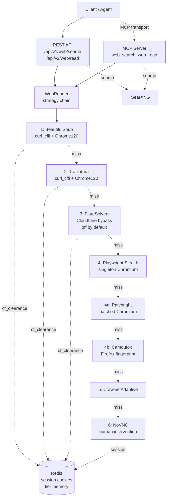

# ascend-web-hunter

*SearXNG meta-search and multi-tier content extraction for the AscendAI platform.*

[](https://www.python.org/)
[](https://fastapi.tiangolo.com/)
[](https://playwright.dev/)
[](#)
[](../../LICENSE)

---

### What it is

ascend-web-hunter is a Python microservice (port 7021) that exposes two surfaces over one process: a REST API for
direct callers and an MCP server for AI agents. It runs SearXNG queries and reads pages through an eight-tier
escalation chain that walks from cheap HTTP fetches to a remote browser session humans can drive over VNC.

Pages get extracted by whichever tier wins first. WAFs (Cloudflare, Turnstile), login walls, and JavaScript
gating each trigger the next tier rather than a generic failure. Clearance cookies and authenticated sessions
land in Redis so the next request to the same domain reuses them.

---

### Quick start

The scrapper compose file is `include:`-d by the main `compose.yaml` at the repo root, so every command runs
against the main file (no `-f` flag).

Set `SEARXNG_SECRET` in the repo-root `.env` first. Compose refuses to start without it, and SearXNG refuses to boot
without it. It must be at least 32 characters, unique to this deployment, and not the literal `ultrasecretkey`.

Bring up the full stack from the repo root:

```bash
docker compose up -d --build
```

Rebuild and recreate only this service after a code change (everything else stays running):

```bash
docker compose up -d --build --force-recreate ascend-web-hunter
```

Tail the logs:

```bash
docker logs --tail 80 -f ascend-web-hunter
```

Hit the health endpoint to verify:

```bash
curl http://localhost:7021/health
```

Local development without Docker is in [docs/running.md](docs/running.md).

---

### Architecture

The strategy chain escalates one tier at a time, bounded by `READ_TOTAL_BUDGET=90s`. NoVNC is the terminal
strategy and exits the loop with a 428 response that asks the human to solve the challenge out-of-band.



Full architecture in [docs/architecture/](docs/architecture/), strategy chain rationale in
[ADR-001](docs/architecture/decisions/ADR-001-multi-tier-extraction-strategy.md), budget and singleton
browser rationale in
[ADR-005](docs/architecture/decisions/ADR-005-strategy-budget-and-singleton-chromium.md).

---

### Features

- **Two surfaces, one process.** REST under `/api/v1`, `/api/v2` and MCP at `/mcp`. Same orchestrator behind
  both. See [docs/api-examples.md](docs/api-examples.md).
- **Eight-tier escalation chain.** Cheap tiers handle the easy 80%, patched browser tiers (`4a-patchright`,
  `4b-camoufox`) cover the sites that fingerprint stock Playwright, the rest escalates to Crawlee and NoVNC for
  the irreducible human-needed cases.
- **PSL-aware cookie persistence.** Clearance cookies keyed by registrable domain via `tldextract`. Sites under
  shared ccTLDs (`*.co.uk`, `*.com.au`) stay isolated. See
  [ADR-002](docs/architecture/decisions/ADR-002-cloudflare-cookie-persistence-redis.md).
- **Singleton Chromium.** One browser process across requests, per-request context. Saves ~1 second per
  Playwright invocation versus the per-request launch pattern.
- **Budget-bounded reads.** `READ_TOTAL_BUDGET=90s` caps wall-clock across tiers 1-5. NoVNC exempt.
- **Structured extraction.** `output_format` `structured` adds embedded JSON-LD, OpenGraph and microdata
  in `metadata`; `schema` extracts caller-defined JSON through a configurable model endpoint with
  self-healing per-domain selector recipes; `tables` returns HTML tables as rows; `screenshot` returns
  a base64 PNG from the serving browser tier.
- **Observability ready.** `/health` (liveness), `/ready` (dependency probes), `/metrics` (Prometheus
  counters), `X-Request-ID` middleware on every response.
- **Remote CAPTCHA solving via Ngrok.** Solve from a phone, no SSH required. See
  [ADR-003](docs/architecture/decisions/ADR-003-novnc-ngrok-captcha-intervention.md).
- **Polling crawl jobs.** `POST /api/v1/crawl/jobs` (answer 202), status, list and cancel, plus the
  `crawl_submit`, `crawl_job_status`, `crawl_list_jobs` and `crawl_cancel_job` MCP tools. Several
  instances share one crawl through Lua-claimed URLs in Redis with per-domain politeness; results land
  in Floci under `tenant/<tenantId>/`; recrawls copy unchanged pages forward server-side. Every seed,
  discovered link, redirect hop, robots.txt and sitemap fetch passes the same SSRF guard and
  connect-time pinning as a single read. Honest ceiling: the hundreds-of-thousands-of-pages class per
  job across several workers. See
  [ADR-019](docs/architecture/decisions/ADR-019-crawl-jobs.md).

---

### Configuration

Settings live in [src/config/config.py](src/config/config.py), bound through pydantic-settings against env vars
and `.env`. The most-used variables:

| Variable             | Default                            | Purpose                                              |
| :------------------- | :--------------------------------- | :--------------------------------------------------- |
| `API_PORT`           | `7021`                             | Service port                                         |
| `SEARXNG_BASE_URL`   | `http://localhost:9020`            | SearXNG meta-search instance                         |
| `FLARESOLVERR_URL`   | `http://localhost:8191/v1`         | FlareSolverr Cloudflare-bypass instance              |
| `FLARESOLVERR_ENABLED` | `false`                          | Route reads through the 3-flaresolverr tier            |
| `CAMOUFOX_ENABLED` | `true`                               | Route reads through the 4b-camoufox tier               |
| `TIER_MEMORY_TTL_SECONDS` | `86400`                       | TTL in seconds for the per-domain tier memory          |
| `NETWORKIDLE_POLL_MS` | `1000`                          | Page-quiet poll interval in milliseconds for browser tiers |
| `SCROLL_PAUSE_MS` | `200`                                | Pause in milliseconds between two scroll steps         |
| `REDIS_URL`          | `redis://127.0.0.1:6379/0`         | Redis for cookie persistence                         |
| `READ_TOTAL_BUDGET`  | `90.0`                             | Wall-clock cap across the strategy chain (seconds)   |
| `PLAYWRIGHT_HEADLESS`| `false`                            | Headless Chromium; flip to `true` in CI / no X       |
| `PUBLIC_VNC_URL`     | `http://localhost:7900`            | NoVNC URL (or `http://ngrok:4040/api/tunnels`)       |
| `NOVNC_TIMEOUT_SECONDS` | `600`                           | NoVNC monitor task lifetime                          |
| `NOVNC_MAX_CONCURRENT_FLOWS` | `4`                      | Maximum concurrent intervention windows per container |
| `NOVNC_DISPLAY_SIZE` | `1920x1080`                      | Shared Xvfb display size, read by Xvfb and the service |
| `NOVNC_WINDOW_WIDTH_PX` | `1280`                      | Width in pixels of each intervention window          |
| `NOVNC_WINDOW_HEIGHT_PX` | `800`                      | Height in pixels of each intervention window         |
| `NOVNC_WINDOW_CASCADE_OFFSET_PX` | `48`                | Cascade step in pixels between intervention windows  |
| `NOVNC_FLOW_LEASE_GRACE_SECONDS` | `30.0`              | Teardown grace before a held flow is reclaimed       |
| `NOVNC_FLOW_SWEEP_INTERVAL_SECONDS` | `30.0`           | Interval in seconds between lease-sweeper runs       |
| `NOVNC_FLOW_CANCEL_GRACE_SECONDS` | `10.0`             | Bounds reclamation and shutdown                      |
| `NOVNC_BUSY_RETRY_AFTER_SECONDS` | `30`                | Short poll interval in the 409 Retry-After header    |
| `NOVNC_PUBLIC_URL` | unset                            | One base address shared by every container; unset keeps `PUBLIC_VNC_URL` |
| `RATE_LIMIT_DEFAULT` | `1200/minute`                    | Flood-protection rate limit for REST routes and MCP tools |
| `ALLOWED_PRIVATE_HOSTS` | empty                         | Hosts the URI fetch guard may reach even at a private address; leave empty, only an e2e sweep sets it |
| `CHALLENGE_DETECTION_MAX_BYTES` | `50000`                  | Prefix length scanned by the vendor, structure and phrase families |
| `CHALLENGE_WALL_MAX_BYTES` | `50000`                      | Page size under which a 403, 429 or 503 body counts as small, and under which the word floor is computed |
| `CHALLENGE_SCORE_THRESHOLD` | `100`                      | Score at or above which a page is a wall |
| `CHALLENGE_RICH_CONTENT_WORDS` | `150`                  | Extracted words at or above which the rich-content guard fires |
| `CHALLENGE_FORM_DOMINANCE_RATIO` | `0.6`               | Share of visible text inside forms at or above which form dominance fires |
| `CHALLENGE_MIN_WORDS_PER_KB` | `2.0`                     | Extracted words per kilobyte of HTML under which thin text fires |
| `CHALLENGE_THIN_LINK_COUNT` | `5`                        | Fewer anchors with href than this fires few links |
| `CHALLENGE_RICH_LINK_COUNT` | `20`                       | At least this many anchors with href fires the many-links guard |
| `CHALLENGE_SHAPE_MAX_BYTES` | `500000`                   | Bounds the extraction the shape family uses |
| `CHALLENGE_WEIGHT_DEFINITIVE_HEADER` | `200`            | Weight of the definitive_header signal |
| `CHALLENGE_WEIGHT_INTERSTITIAL_STRUCTURE` | `80`       | Weight of the interstitial_structure signal |
| `CHALLENGE_WEIGHT_VENDOR_SCRIPT` | `60`                   | Weight of the vendor_script signal |
| `CHALLENGE_WEIGHT_VENDOR_PRESENCE` | `30`               | Weight of the vendor_presence signal |
| `CHALLENGE_WEIGHT_STATUS_EMPTY_BODY` | `200`             | Weight of the status_empty_body signal |
| `CHALLENGE_WEIGHT_STATUS_SMALL_BODY` | `50`              | Weight of the status_small_body signal |
| `CHALLENGE_WEIGHT_STATUS_LARGE_BODY` | `20`              | Weight of the status_large_body signal |
| `CHALLENGE_WEIGHT_CAPTCHA_INPUT` | `50`                   | Weight of the captcha_input signal |
| `CHALLENGE_WEIGHT_CAPTCHA_ELEMENT` | `40`                 | Weight of the captcha_element signal |
| `CHALLENGE_WEIGHT_FORM_DOMINANCE` | `40`                | Weight of the form_dominance signal |
| `CHALLENGE_WEIGHT_SCRIPT_ONLY_BODY` | `40`              | Weight of the script_only_body signal |
| `CHALLENGE_WEIGHT_THIN_TEXT` | `20`                       | Weight of the thin_text signal |
| `CHALLENGE_WEIGHT_FEW_LINKS` | `20`                       | Weight of the few_links signal |
| `CHALLENGE_WEIGHT_NO_ARTICLE` | `20`                      | Weight of the no_article signal |
| `CHALLENGE_WEIGHT_RICH_CONTENT` | `-60`                  | Weight of the rich_content guard signal |
| `CHALLENGE_WEIGHT_MANY_LINKS` | `-20`                    | Weight of the many_links guard signal |
| `CHALLENGE_WEIGHT_PHRASE_TITLE` | `60`                   | Weight of the phrase_title signal |
| `CHALLENGE_WEIGHT_PHRASE_BODY` | `30`                    | Weight of the phrase_body signal |
| `EXTRACTION_SCHEMA_MAX_BYTES` | `16384`                    | Maximum size in bytes of the caller-supplied extraction schema |
| `EXTRACTION_LLM_BASE_URL` | empty                          | Base URL of the OpenAI-compatible extraction endpoint; empty turns the schema format off |
| `EXTRACTION_LLM_MODEL` | empty                           | Model name sent to the extraction endpoint |
| `EXTRACTION_LLM_API_KEY` | empty                          | API key for the extraction endpoint, read from the repository `.env` file only |
| `EXTRACTION_LLM_MAX_INPUT_CHARS` | `60000`                 | Page text characters sent to the extraction endpoint before the cap cuts them |
| `EXTRACTION_LLM_TIMEOUT_SECONDS` | `60`                   | Timeout in seconds for one extraction model call |
| `RECIPE_TTL_SECONDS` | `604800`                          | TTL in seconds for a stored extraction recipe |
| `RECIPE_SELECTOR_MAX_CHARS` | `512`                      | Maximum characters of one stored CSS selector |
| `DOCUMENT_MAX_BYTES` | `52428800`                        | Maximum bytes fetched for one routed PDF, image or audio file |
| `DOCLING_SERVE_URL` | `http://docling-serve:5001`          | Base URL of the docling-serve conversion service; empty turns the PDF route off |
| `ASCEND_OCR_URL` | `http://ascend-ocr:7022`                | Base URL of the ascend-ocr service; empty turns the image route off |
| `OCR_ROUTE_TIMEOUT_SECONDS` | `300`                       | Timeout in seconds polling one ascend-ocr job |
| `AUDIO_SCRIBE_URL` | `http://ascend-audio-scribe:7017`   | Base URL of the ascend-audio-scribe service; empty turns the audio route off |
| `READ_CACHE_PURGE_RECONNECT_SECONDS` | `5`                | Wait in seconds between two connection attempts of the read cache purge subscriber |
| `CRAWL_MAX_SEEDS` | `20`                                     | Most seeds in one crawl request |
| `CRAWL_MAX_PATTERNS` | `50`                                  | Most include patterns and most exclude patterns in one crawl request |
| `CRAWL_MAX_DEPTH` | `5`                                        | Largest `max_depth` a crawl request may ask for |
| `CRAWL_DEFAULT_DEPTH` | `2`                                  | `max_depth` when the request has none |
| `CRAWL_MAX_PAGES` | `10000`                                   | Largest `page_budget` a crawl request may ask for |
| `CRAWL_DEFAULT_PAGE_BUDGET` | `100`                          | `page_budget` when the request has none |
| `CRAWL_ROBOTS_OPT_OUT_DOMAINS` | empty                      | Seed domains for which `respect_robots` false is accepted |
| `CRAWL_RESULT_S3_BUCKET` | `web-hunter-crawls`                 | Bucket of the crawl results |
| `CRAWL_RESULT_S3_PREFIX` | `crawl-results/`                   | Key prefix of the crawl results after the tenant prefix |
| `CRAWL_JOB_RETENTION_SECONDS` | `604800`                     | Lifetime of job records, results, frontier keys and recrawl state |
| `CRAWL_DOMAIN_CONCURRENCY` | `2`                            | Pages of one domain read at once, all instances together |
| `CRAWL_DEFAULT_DELAY_SECONDS` | `1`                         | Least time between two fetches of one domain |
| `CRAWL_PROXY_URL` | empty                                    | Customer proxy for crawl fetches only |
| `CRAWL_CLAIM_LEASE_SECONDS` | `120`                         | Lifetime of a page claim |
| `CRAWL_CLAIM_MAX_EXPIRIES` | `2`                           | Claim expiries after which a URL counts as failed |
| `CRAWL_WORKER_CONCURRENCY` | `4`                           | Crawl worker tasks each instance starts |
| `CRAWL_WORKER_IDLE_SECONDS` | `1`                           | Wait of a worker that found nothing to claim |
| `CRAWL_POLL_AFTER_SECONDS` | `5`                            | The `poll_after_seconds` hint of a crawl submission |
| `OBJECT_STORE_S3_ENDPOINT` | `http://localhost:9070`           | Address of the S3-compatible store |
| `OBJECT_STORE_S3_ACCESS_KEY` | empty                        | Access key of the store |
| `OBJECT_STORE_S3_SECRET_KEY` | empty                        | Secret key of the store |

Full settings reference in [docs/configuration.md](docs/configuration.md).

---

### Agent skill

A drop-in skill ships at [skills/ascend-web-hunter/SKILL.md](skills/ascend-web-hunter/SKILL.md). Copy
[skills/ascend-web-hunter/](skills/ascend-web-hunter/) into your agent's skills folder
(`.claude/skills/`, `.agents/skills/`, `.opencode/skills/`) and the agent picks it up automatically. The
skill covers search, read, and the session establish/status/clear endpoints, the
`human_intervention_required` response shape, and the captcha-solve-then-resume flow.

---

### Docs map

| File | What's in it |
| :--- | :--- |
| [docs/running.md](docs/running.md) | Local Python and Docker run instructions, MCP client setup |
| [deploy-standalone/README.md](deploy-standalone/README.md) | Copy-and-run bundle for deploying this stack to a host of its own |
| [docs/api-examples.md](docs/api-examples.md) | REST and MCP request examples (curl + PowerShell) |
| [docs/configuration.md](docs/configuration.md) | Every settings field with defaults and effect |
| [docs/troubleshooting.md](docs/troubleshooting.md) | Reinstalling deps, common failure modes |
| [docs/architecture/README.md](docs/architecture/README.md) | Architecture index: arc42 chapters, ADRs, diagrams |
| [docs/architecture/decisions/](docs/architecture/decisions/) | ADRs (strategy chain, cookie persistence, NoVNC, SearXNG, budget) |
| [AGENTS.md](AGENTS.md) | Module-level instructions for AI coding agents |
| [CHANGELOG.md](CHANGELOG.md) | Structural changes per release |
| [../../README.md](../../README.md) | Monorepo overview |

---

### License

MIT. See the top-level [LICENSE](../../LICENSE) at the monorepo root.
