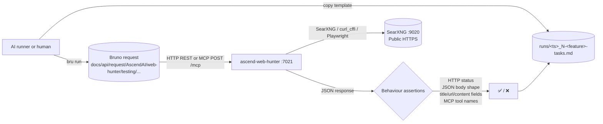

# ascend-web-hunter: end-to-end capability tests

Manual / AI-runnable e2e suite for the ascend-web-hunter module. Each test exercises **one capability** end-to-end
against a live ascend-web-hunter container on port 7021. Assertions are observable behaviour only - HTTP status
codes, JSON response body shape and content, the MCP `tools/list` enumeration, and the MCP `tools/call` payload.
ascend-web-hunter keeps no per-user state beyond a Redis-backed session cache keyed by URL / extraction context;
the search path itself is stateless. Where a test needs reproducible upstream conditions, the reset step calls
the appropriate Redis key wipe.

Before running this suite, or any other e2e suite, pick a run scenario or a service suite from [docs/E2E_RUN_SCENARIOS.md](../../../docs/E2E_RUN_SCENARIOS.md). To run only this suite, use its entry under [Service suites](../../../docs/E2E_RUN_SCENARIOS.md#ascend-web-hunter-service-suite).

## What's here

```text
apps/ascend-web-hunter/e2e/
├── README.md                            # this file
├── fixtures/                            # canary inputs and seed data
│   ├── README.md
│   ├── session-clear-seed.json          # synthetic session record seeded by test 8
│   ├── session-import-mixed.json        # synthetic storage_state seeded by test 17
│   └── session-status-expired-seed.json # synthetic session record seeded by test 9
├── harness/                             # scripted-login helper for test 7
│   └── seed_authenticated_session.py
└── testing/                             # numbered specs + templates/ + runs/
    ├── README.md
    ├── 1-invalid-input-test.md          # immutable spec (lowest cost - no SearXNG, no internet egress)
    ├── 2-search-happy-path-test.md
    ├── 3-read-example-com-test.md
    ├── 4-mcp-tools-list-test.md
    ├── 5-mcp-search-test.md
    ├── 6-tiered-scraping-test.md
    ├── 7-authenticated-realworld-scraping-test.md
    ├── 8-session-clear-test.md
    ├── 9-session-status-test.md
    ├── 10-session-establish-test.md
    ├── 11-captcha-solve-and-capture-test.md
    ├── 12-clearance-reuse-test.md
    ├── 13-structured-extraction-test.md
    ├── 14-document-routing-test.md
    ├── 15-schema-extraction-ai-test.md
    ├── 16-crawl-jobs-test.md
    ├── 17-session-import-test.md
    ├── 18-tier-ladder-and-guard-test.md
    ├── 19-challenge-verdicts-test.md
    ├── 20-concurrent-interventions-test.md
    ├── 21-platform-contract-test.md
    ├── templates/                       # run-record templates (immutable), one per spec
    │   ├── README.md
    │   ├── 1-invalid-input-tasks.template.md
    │   ├── 2-search-happy-path-tasks.template.md
    │   ├── 3-read-example-com-tasks.template.md
    │   ├── 4-mcp-tools-list-tasks.template.md
    │   ├── 5-mcp-search-tasks.template.md
    │   ├── 6-tiered-scraping-tasks.template.md
    │   ├── 7-authenticated-realworld-scraping-tasks.template.md
    │   ├── 8-session-clear-tasks.template.md
    │   ├── 9-session-status-tasks.template.md
    │   ├── 10-session-establish-tasks.template.md
    │   ├── 11-captcha-solve-and-capture-tasks.template.md
    │   ├── 12-clearance-reuse-tasks.template.md
    │   ├── 13-structured-extraction-tasks.template.md
    │   ├── 14-document-routing-tasks.template.md
    │   ├── 15-schema-extraction-ai-tasks.template.md
    │   ├── 16-crawl-jobs-tasks.template.md
    │   ├── 17-session-import-tasks.template.md
    │   ├── 18-tier-ladder-and-guard-tasks.template.md
    │   ├── 19-challenge-verdicts-tasks.template.md
    │   ├── 20-concurrent-interventions-tasks.template.md
    │   └── 21-platform-contract-tasks.template.md
    └── runs/
        ├── README.md
        └── <UTC-timestamp>_<N>-<capability>-tasks.md   # one per executed test (gitignored)
```

Tests are number-prefixed by setup cost. `1` runs offline (REST validator short-circuit, no SearXNG hit); `2` needs
SearXNG reachable; `3` needs outbound HTTPS to `example.com` via the tiered extraction stack (curl_cffi tier is
sufficient); `4` only needs the ascend-web-hunter process itself; `5` needs SearXNG again via the MCP path; `6` needs
a browser tier plus outbound HTTPS to real sites for a per-tier regression sweep (curl_cffi, Playwright, patched
browser); `7` needs browser tiers, a real-world URL matrix and the saucedemo login-seed harness under
[harness/](harness/seed_authenticated_session.py), with no human step; `8` and
`9` only need the ascend-web-hunter process and Redis reachable via `docker exec` - no outbound egress at all; `10`
needs no egress either but launches a real headful Playwright browser held by a background monitor for up to 10
minutes - see its own spec for why that keeps it out of the cheap tier despite not touching SearXNG, a browser tier
for extraction, or any external site. Spec `11` needs a browser tier, NoVNC and a human to tick the hCaptcha widget on the democaptcha
demo form, and asserts the capture that solve leaves behind, so it runs last and only on a human's go. Spec `12`
needs a browser tier and outbound HTTPS to one Cloudflare-protected site, and proves the stored clearance is reused on
a second read of that site with no human, so it runs after spec `6`, which reads the same site. Spec `13` needs the
shared fake site and a real browser for the screenshot step, spec `14` needs the full stack (docling-serve,
ascend-ocr, ascend-audio-scribe) and runs alone in the quarantine lane, and spec `15` needs the hosted model from
the scenario preconditions. Spec `17` stores an out-of-band session over HTTP with no egress, running after
spec `8` and before spec `10`. Twenty one specs in all,
twenty of them automated.

The Bruno collection isn't here. It lives at the **repo root** under
`docs/api/request/AscendAI/web-hunter/testing/` so it stays a portable API client artifact. Each spec references
the matching Bruno request file under that path. (The pre-existing ad-hoc requests directly under
`docs/api/request/AscendAI/web-hunter/` are kept untouched as dev-time fixtures; e2e specs only point at the
`testing/` subfolder.)

## Flow



Every spec follows the same template:

1. **What this verifies.** Bullet list of behaviours.
2. **Prerequisites.** Concrete check commands the runner executes before starting. Each command is its own code
   block; the prose around it states what success looks like.
3. **Reset state.** One command per code block, executed in order, to wipe state so the test is reproducible. Most
   ascend-web-hunter tests do not need reset; the v2 read tests can optionally flush the Redis session cache.
4. **Run.** One or more numbered steps. Each step is a single Bruno CLI invocation (or, for MCP tests, a `curl`
   handshake followed by Bruno). Steps wait for HTTP 200 before continuing.
5. **Expected.** Observable behaviour only: HTTP status, JSON body shape, list-element keys (`title`, `url`,
   `content`), MCP tool registry contents. No log substrings.
6. **Fixtures.** Paths to local files the test reads (none for the current suite).

The paired `templates/<N>-<feature>-tasks.template.md` is the runner's checklist for one execution: prerequisites,
reset state, run steps, expected, verdict, plus **Result summary** (with **Input tokens**, **Output tokens**,
**Start (UTC)**, **End (UTC)**, **Duration** fields) and **Additional tasks I did** (anything done outside the
spec). The runner copies the template from [testing/templates/](testing/templates/) into [testing/runs/](testing/runs/)
as `<UTC-timestamp>_<N>-<feature>-tasks.md` and fills it in. ascend-web-hunter specs make no paid call (SearXNG,
curl_cffi, and Playwright only), so [docs/E2E_COST.md](../../../docs/E2E_COST.md) records this module as a
zero-cost row rather than tracking tokens here.

Deterministic first: a behaviour checkable by HTTP status, response body, or persisted state (Redis, the object store,
Postgres, Qdrant, the fake site request log) is checked by a Bruno request with its assertions inside the request file,
and no AI model decides the verdict. An AI-run spec is added only where the result needs a real model (schema extraction,
a chat that must call a tool, a retrieval answer). A new spec takes the next free number at implementation time. When a
feature changes, its existing spec and template are updated in place under the same number, and a new spec is written only
when no existing spec can be updated to cover the change (owner answer 67.2 of 2026-10-04).

## Parallelism and execution order

ascend-web-hunter holds no per-user state in Postgres or Qdrant - only a Redis session cache for the extraction
pipeline plus an in-process blocklist. The execution constraints:

| Constraint | Tests | Why |
| :--- | :--- | :--- |
| Redis-cache shared key | 3 | The v2 read test for `example.com` may share a Redis cache key with any other read against the same URL. Two concurrent runs against the same URL are still safe (the cache is read-after-write idempotent), but a deterministic cold run can flush the URL's key first. Also conflicts with test 8: test 8's idempotent-clear call for `example.com` asserts `cleared_cache_entries=0`, which fails if test 3 has already populated that domain's per-process read cache. |
| No cross-test interference | 1, 2, 4, 5 | Search calls write only to ephemeral SearXNG cache (out of process). MCP-list and invalid-input tests touch no upstream service. |
| Domain-scoped Redis session/cookie cache | 6 | Mutates Redis session keys for its own target domains (`en.wikipedia.org`, `scrapingcourse.com`, `quotes.toscrape.com`). No overlap with test 3's `example.com` key. Safe in parallel with 1, 2, 4, 5. |
| Domain-scoped Redis session keys, fully automated | 7 | Part 1 (matrix) and Part 2 (automated saucedemo login) may fan out across parallel runners, with Part 2's three steps kept in order on one runner. No human step since the hCaptcha solve moved to test 11. Mutates Redis session keys for the matrix domains and `saucedemo.com`, with no overlap with test 6's domains. Its reset flushes every `session:*` key, so it must not run while test 11 holds its democaptcha capture between its two calls. Row u's 428 holds one NoVNC window slot test 11's human may need, and the matrix must not run beside spec 20, which fills every window slot on purpose. |
| Domain-scoped Redis session key, no egress | 8 | Mutates only `session:example.net:default`, seeded and removed by the test itself. Conflicts with test 10, which writes `session:example.net:e2e-establish` as a side effect of `session/establish` (see test 10's own spec): a different key, but one that would appear in the `session:*` scan this test compares before and after. Also conflicts with test 3: test 3's read of `example.com` populates the same per-domain read cache that test 8's idempotent-clear call for `example.com` asserts is empty (`cleared_cache_entries=0`), so running them together fails that assertion. Safe in parallel with 1, 2, 4, 5, 9. Its final "no collateral damage" check compares the whole `session:*` key set against a pre-test baseline. That comparison is meaningful only when test 8 runs in isolation, since any test that mutates any session key while it is running, not only test 3 or 10, makes it fail. |
| Domain-scoped Redis session key, no egress | 9 | Mutates only `session:example.org:default`, seeded twice and removed by the test itself. No overlap with test 8's or test 10's `example.net` key or any other test's domains. Safe in parallel with 1, 2, 4, 5, 8, 10. |
| `session:example.net:e2e-establish`, plus a long-lived background browser | 10 | `session/establish` was assumed to write no session record until this spec was run live against port 7021, which showed otherwise within 15 seconds: the monitor's "cleared" check accepts any unchallenged page, so it captures an (often empty) session on the very first poll, as though a challenge had just been solved. See the spec's "Two behaviours this spec found live, not assumed" section. This test writes `session:example.net:e2e-establish` and cleans the key up itself. That is not the key test 8 seeds and clears, but test 8 compares a scan of `session:*` before and after its run, so this key would appear in that scan and fail it. It also leaves a real headful Playwright browser + NoVNC monitor running in the `ascend-web-hunter` container for up to 10 minutes after its own assertions pass if the monitor does not resolve within one poll cycle. Avoid running it back to back with itself for the same reason. Its flow holds one NoVNC window slot until the monitor resolves, so not beside spec 20, which fills every slot on purpose, or test 11's human window. |
| Human-in-the-loop, must run on the main session | 11 | Call 1's read of the democaptcha hCaptcha demo form surfaces a `vnc_url` a human must open, and the capture check then proves the solve left `session:democaptcha.com:default` behind with the `hmt_id` cookie. Reuse is not asserted here, that is test 12's job. It cannot be delegated to a fanned-out subagent whose output is never shown to the user. Mutates `session:democaptcha.com:default` and holds one NoVNC window slot while the human window is open, so it conflicts with any spec that opens a NoVNC flow (test 7's row u, test 10, spec 20) and with test 7's `session:*` flush. Runs alone, last, and only on a human's go. |
| Domain-scoped Redis session key, shared with test 6, fully automated | 12 | Mutates `session:scrapingcourse.com:default` and the reader's in-process read cache for that domain, the same site and key test 6's Cloudflare row writes, so it must not run alongside test 6 and runs after it. Its key would appear in the `session:*` scan tests 8 and 10 compare, so it must not run alongside them either, and test 7's reset flushes every `session:*` key, which would wipe the capture between its two calls. On the A61 failure path its Call 2 holds one NoVNC window slot, and spec 20 fills every window slot on purpose, so never beside it. Safe in parallel with 1, 2, 3, 4, 5, 9. No human. |
| Reads only, no shared state | 13 | Fetches three fake-site pages through the tier chain with a real browser for the screenshot step. Opens no NoVNC flow and writes no key any other spec reads. Safe beside every spec. |
| Quarantine lane, full stack | 14 | Docling-bound (step 1) and OCR engine-bound (step 2), so the whole spec runs alone in the quarantine lane with the other exclusive specs. Mutates `session:*` for no domain (no login), but its OCR jobs live in the shared ascend-ocr queue, so no other OCR or docling work may run beside it. Safe beside nothing while it runs; its reset deletes the OCR jobs it created. |
| Redis recipe keys only, AI-run | 15 | Writes only `recipe:e2e-fake-site:*`, seeded and removed by the test itself except for the TTL the scenario preconditions grant. No overlap with any session key. Safe beside every spec. Token use goes into the run record. |
| Crawl jobs with tenant isolation, recrawl and cancel | 16 | Mutates only the two tenants' crawl data (`tenant/e2e-crawl-a/`, `tenant/e2e-crawl-b/`, `crawl_*:e2e-crawl-a:*`, `crawl_*:e2e-crawl-b:*`) and the fake site request log, which its reset empties. Runs beside every spec that does not reset that log. |
| Domain-scoped Redis session key, no egress | 17 | Writes only `session:example.net:e2e-import`, seeded and removed by the test itself. Conflicts with test 7 (its reset flushes every `session:*` key) and with tests 8 and 10 (both scan or write `example.net` session keys). Safe in parallel with everything else in the suite. |
| Reads only, no shared state | 21 | The platform contract reads `/health`, `/ready` and `/metrics` and answers problem bodies and refusals only. It writes no `session:*` key and no crawl, recipe or tier-memory key. Its errors-counter assertion depends on no other spec answering an unknown path, which none of the others do, so it is safe beside every spec. |

Recommended layout: run test 1 first (offline, fail-fast on validator bugs without burning egress), then test
16 (its reset empties the fake site request log, so tests 13, 14 and 15, which assert on that log, never
overlap it), then tests
2, 4, 5, 9, 13, 15 in parallel or sequential (none needs a browser tier for extraction, and only 13's screenshot step needs the
image's Playwright), then test 6 (highest egress cost,
needs browser tiers and Playwright), then test 12 (after test 6 because both write `session:scrapingcourse.com:default`,
and before test 7 because test 7's reset would wipe its capture), then test 14 alone in the quarantine lane, then test 7 (also browser tiers and Playwright, fully
automated now, after test 6 because its reset flushes every `session:*` key), then tests 3, 8, 17 and 10 one at a time (never
together: test 10's `session:example.net:e2e-establish` key would appear in the `session:*` scan test 8 compares
before and after), with test 10 last of the two, since its assertions finish in seconds but the background browser it
can leave running should not overlap with a repeat of itself either. Test 11 runs last of all, alone, and only on a
human's go, because its human solve needs the main session and one NoVNC window slot.

## Prerequisites before any test

1. Docker compose stack up: the `ascend-scrapper` project group needs to be running - `ascend-web-hunter` and
   `searxng` containers all healthy.
2. `curl -fsS http://localhost:7021/health` returns HTTP 200 with `status` `ok`, `service` `ascend-web-hunter` and a non-empty `version`.
3. `curl -fsS "http://localhost:9020/search?q=test&format=html"` returns HTTP 200 with HTML content (proves SearXNG
   is reachable from the host).
4. Bruno CLI installed: `bru --version` returns a version string. Install once with `npm install -g @usebruno/cli`.
5. Deterministic fake site running as one container on the compose network `ascend-ai_default` (the network `ascend-web-hunter` uses, checked with `docker network ls` on 2026-10-07) with the two network names `e2e-fake-site` and `e2e-fake-site-blocked` (design D12 of `add-web-search-scraping-e2e`). Image `e2e-fake-site:latest` serves on `127.0.0.1:7031`. Start it before the first spec:

```powershell
docker run -d --name e2e-fake-site --network ascend-ai_default --network-alias e2e-fake-site --network-alias e2e-fake-site-blocked -p 127.0.0.1:7031:7031 e2e-fake-site:latest
```

```powershell
curl -fsS http://127.0.0.1:7031/__requests
```

The second command returns the request log (`{"requests":[]}` on a fresh start) and proves the runner reaches the fake site from the host. From inside `ascend-web-hunter` both names resolve to the same private address:

```powershell
docker exec ascend-web-hunter getent hosts e2e-fake-site
```

```powershell
docker exec ascend-web-hunter getent hosts e2e-fake-site-blocked
```

6. Before the first spec that reads the fake site, recreate `ascend-web-hunter` once with the allow list value set in the
   shell of that one command, a state change the runner asks the owner for in one line. The value is not a secret, so it
   may sit in the shell of one command. Then assert the value reached the container, and stop the sweep as an
   environment failure otherwise. Bash:

```bash
WEB_HUNTER_ALLOWED_PRIVATE_HOSTS=e2e-fake-site docker compose up -d ascend-web-hunter
```

PowerShell, three blocks:

```powershell
$env:WEB_HUNTER_ALLOWED_PRIVATE_HOSTS = "e2e-fake-site"
```

```powershell
docker compose up -d ascend-web-hunter
```

```powershell
Remove-Item Env:WEB_HUNTER_ALLOWED_PRIVATE_HOSTS
```

Then assert, in one of the two forms:

```bash
docker exec ascend-web-hunter printenv ALLOWED_PRIVATE_HOSTS
```

```powershell
docker exec ascend-web-hunter printenv ALLOWED_PRIVATE_HOSTS
```

Expect exactly `e2e-fake-site`. Anything else stops the sweep as an environment failure, never a product failure.

7. After the last spec of the sweep, always, also when a spec failed or the sweep was stopped, recreate
   `ascend-web-hunter` once with the variable unset and check the container holds no allowed host, then remove the fake
   site:

```bash
docker compose up -d ascend-web-hunter
```

```bash
docker exec ascend-web-hunter printenv ALLOWED_PRIVATE_HOSTS
```

The `printenv` prints nothing. Then remove the fake site:

```powershell
docker rm -f e2e-fake-site
```

When the scraping file runs alone with `COMPOSE_PROFILES=redis` and `REDIS_URL=redis://redis:6379/0` in `.env`, the
session store is the container `ascend-scrapper-redis`, so every `docker exec redis` command in these specs targets
that container instead.

If the ascend-web-hunter startup readiness banner shows any `[FAILED]` rows for upstream services, fix the
connectivity before running the suite.

## Running tests

Install Bruno CLI once.

```powershell
npm install -g @usebruno/cli
```

Run one capability.

```powershell
cd docs/api/request/AscendAI
```

```powershell
bru run "web-hunter/testing/search-stable-query.yml" --env ascend-local
```

Run the whole `testing/` suite (Bruno's directory mode).

```powershell
cd docs/api/request/AscendAI
```

```powershell
bru run "web-hunter/testing" --env ascend-local
```

## Capability tests

Numbered by setup cost. Easiest first.

| #  | Spec | What it proves |
| :- | :--- | :--- |
| 1  | [testing/1-invalid-input-test.md](testing/1-invalid-input-test.md) | `GET /api/v1/web/search` with a blank `query` returns HTTP 400; with an over-length `query` returns HTTP 400. No SearXNG egress required. |
| 2  | [testing/2-search-happy-path-test.md](testing/2-search-happy-path-test.md) | `GET /api/v1/web/search?query=OpenStreetMap&limit=3` returns HTTP 200 with a JSON array of ≥ 1 result; each entry has `title`, `url`, `content`. |
| 3  | [testing/3-read-example-com-test.md](testing/3-read-example-com-test.md) | `POST /api/v2/web/read` with `https://www.example.com/` returns HTTP 200, `status="success"`, and the extracted content contains `"Example Domain"`. |
| 4  | [testing/4-mcp-tools-list-test.md](testing/4-mcp-tools-list-test.md) | MCP `tools/list` returns an entry with `name="web_search"` and one with `name="web_read"`, each carrying a `query` (or `url`) parameter in its input schema. |
| 5  | [testing/5-mcp-search-test.md](testing/5-mcp-search-test.md) | MCP `tools/call` for `web_search` with a stable query returns a structured result containing ≥ 1 entry with `title`, `url`, `content`. |
| 6  | [testing/6-tiered-scraping-test.md](testing/6-tiered-scraping-test.md) | `POST /api/v2/web/read` against a tier-mapped list (Wikipedia static, `scrapingcourse.com` Cloudflare, `quotes.toscrape.com/js/` JS-rendered) returns HTTP 200 `status="success"` with the per-tier canary content. Highest egress cost - needs browser tiers, runs last. |
| 7  | [testing/7-authenticated-realworld-scraping-test.md](testing/7-authenticated-realworld-scraping-test.md) | Two automated parts, no human step. Part 1: a difficulty-graded real-world URL matrix (easy/medium/hard/very-hard static+JS+WAF → `success`, dead domain → `hard-fail` HTTP 400, LinkedIn/indeed-auth login walls → `intervention` HTTP 428) where gated canaries hard-assert and live sites assert a valid terminal verdict (success or intervention). Five retail anti-bot rows (Allegro plus Amazon PL/US/UK/SE product pages) are best-effort on which branch fires and content-gated on the success branch: a `200`/`success` must carry the requested product page's identity canary (ISBN-13 / ASIN / model code) and none of the measured interstitial or block-page markers, so an anti-bot interstitial can never be recorded as a successful scrape. Five gated challenge-wall rows in other languages (Amazon DE/FR/IT/ES/JP validateCaptcha pages → `intervention`) and three gated widget-not-wall rows (FriendlyCaptcha / MTCaptcha / hCaptcha homepages → `success` with their word-count canary). A row answering HTTP 409 with `code="novnc_busy"` is not a verdict: the runner waits the response's `Retry-After` seconds and re-runs the row, up to 3 attempts in total, records each attempt and each 409 body's `holder_url` in the run record, and fails the row only on the third 409. Part 2: a 2-call login-reuse behaviour, where a scripted login on a stable SPA (`saucedemo.com`, public demo creds hardcoded, no secrets) seeds `storage_state` over HTTP (`POST /api/v2/web/session/import`, profile `e2e`) and proves browser-tier authenticated capture and replay. The human-solved hCaptcha that used to be Part 3 is test 11. |
| 8  | [testing/8-session-clear-test.md](testing/8-session-clear-test.md) | `POST /api/v2/web/session/clear`, the operator-recovery path for a poisoned session. A session seeded directly in Redis for `example.net` is removed (`existed=true`, key gone from Redis afterward). A call against `example.com`, which never carried one, is a documented no-op (HTTP 200, `existed=false`, not a 404 or 500). No browser tier or human needed, so it is the cheapest test in the suite alongside 1 and 4. Do not run in parallel with test 10: its `session:example.net:e2e-establish` key would appear in the `session:*` scan this test compares before and after. |
| 9  | [testing/9-session-status-test.md](testing/9-session-status-test.md) | `POST /api/v2/web/session/status` across all three states its own type declares: `none` for a URL that never carried a session, `expired` for one seeded with a `saved_at` outside the 14-day auth TTL, and `active` for the same key re-seeded with a fresh `saved_at`. Redis-only, no egress - same cost tier as 1, 4, and 8. |
| 10 | [testing/10-session-establish-test.md](testing/10-session-establish-test.md) | `POST /api/v2/web/session/establish`, the proactive counterpart to passive NoVNC capture. Asserts the immediate response (`status="login_required"`, echoed `target`, non-empty `vnc_url`), plus a live-verified finding this spec documents rather than assumes: the background monitor's "cleared" check accepts any unchallenged page, so it captures an (often empty) session on the very first poll, about 15 seconds in, even though nobody solved a challenge. Makes no priced call and needs no human, but launches a real headful Playwright browser that can be held by a background monitor for up to 10 minutes, the highest per-run resource cost in this module's suite. Do not run in parallel with test 8 (the `session:example.net:e2e-establish` key this test writes would appear in the `session:*` scan test 8 compares before and after) or with itself. See the spec's own cost note. |
| 11 | [testing/11-captcha-solve-and-capture-test.md](testing/11-captcha-solve-and-capture-test.md) | Human-solved hCaptcha and its capture on the democaptcha demo form (`https://democaptcha.com/demo-form-eng/hcaptcha.html`), whose `hcaptcha.com/1/api.js` script is a block signature for every automated tier. Call 1 with no session answers HTTP 428, `code="human_intervention_required"` and a `vnc_url` the main agent prints for the human. After the human ticks the widget and submits the form through NoVNC, `session:democaptcha.com:default` holds the `hmt_id` cookie hCaptcha sets on the checkbox click (proof a human acted, not that the image task was solved). Part 2 opens two windows at once (profiles `e2e-h1` then `e2e-h2`, two `vnc_url` values and slots printed) and solves them out of order (`e2e-h2` first): after each solve the listing frees exactly that flow's slot, and each profile's session holds `hmt_id` while the other key is unchanged. Reuse of the capture is not asserted here: the form renders its widget on every load, so a second read of it can never show reuse (register A60), and spec 12 proves reuse on a site whose wall disappears once the clearance is stored. Runs alone, last, main session only, on a human's go. |
| 12 | [testing/12-clearance-reuse-test.md](testing/12-clearance-reuse-test.md) | Stored Cloudflare clearance reused on a second read of the same site, fully automated. Call 1 reads `https://www.scrapingcourse.com/cloudflare-challenge` with no stored session and must answer HTTP 200, `status="success"` and at least 50 characters of content (served by a browser tier), leaving `session:scrapingcourse.com:default` behind with a `cf_clearance` cookie in its `waf` entry. Call 2 reads the same page as `?reuse=1`, a different address so the reader's five-minute in-memory read cache cannot answer it, and must answer HTTP 200, `status="success"`, at least 50 characters of content, no `vnc_url`, never a 428, and faster than Call 1. Both calls' `mode` and duration go into the run record. A 428 on Call 2 is a FAIL and is register defect A61 until its fix lands. Runs after test 6, which reads the same site, and not alongside tests 6, 7, 8 or 10. No human. |
| 13 | [testing/13-structured-extraction-test.md](testing/13-structured-extraction-test.md) | Deterministic formats on the shared fake site, no model. The JSON-LD product page read as `structured` answers HTTP 200 with the article fields and a `metadata` object holding the canary name and price. The table page read as `tables` answers HTTP 200 with the fixture's rows, cell for cell. The article read twice as `screenshot` on tier `4-playwright_stealth` answers HTTP 200 both times with a base64 PNG, and the request log shows two requests to the article, proving no read-cache hit. Reads only, safe beside every spec. |
| 14 | [testing/14-document-routing-test.md](testing/14-document-routing-test.md) | Non-HTML routing against the full stack, no model. Direct reads of the canary PDF, PNG and MP3 answer HTTP 200 with Markdown holding each canary; the OCR job list holds the image job in a terminal state; the oversized PDF and the blocked-link page answer HTTP 200 with a `routing_error` and no body bytes to the private path. OCR engine-bound and docling-bound, so the whole spec runs alone in the quarantine lane. |
| 15 | [testing/15-schema-extraction-ai-test.md](testing/15-schema-extraction-ai-test.md) | Schema extraction with the real hosted model (provider `minimax`, model `MiniMax-M2.7`, never LM Studio). The product page with a name and price schema answers HTTP 200 with validated JSON; Redis holds the `recipe:e2e-fake-site:*` key with a TTL; replay, drift rebuild, second-schema separation, prompt-injection resistance and the unsatisfiable-schema 502 are each asserted. Token use goes into the run record and the spec's `docs/E2E_COST.md` row. |
| 16 | [testing/16-crawl-jobs-test.md](testing/16-crawl-jobs-test.md) | Crawl jobs on the shared fake site's crawl tree, no model. A submission for `e2e-crawl-a` answers HTTP 202 `waiting` and reaches `succeeded` with the `poll_after_seconds` hint. Its `pages.ndjson` in the crawl bucket holds at most the 5 pages of the budget, none deeper than `max_depth` 2, none outside the include pattern and not the disallowed path, the request log holds no request to the disallowed path and none to the blocked name, and the job counts hold at least one `skipped_unsafe`. An identical recrawl marks the unchanged pages `unchanged` under their own key and the request log shows `If-None-Match` or `If-Modified-Since`. The `e2e-crawl-b` jobs never appear in the `e2e-crawl-a` listing. A `running` job cancelled with `DELETE /api/v1/crawl/jobs/{job_id}` reads `cancelled`. Its reset empties the fake site request log, so it runs after test 1 and before tests 13, 14 and 15. |
| 17 | [testing/17-session-import-test.md](testing/17-session-import-test.md) | `POST /api/v2/web/session/import` stores an out-of-band Playwright `storage_state` under profile `e2e-import`, keeping only the URL domain cookies and dropping the rest; the import reads back `active` via `session/status` and clears via `session/clear`. Redis-only, no egress. Runs after spec 8 and before spec 10. |
| 18 | [testing/18-tier-ladder-and-guard-test.md](testing/18-tier-ladder-and-guard-test.md) | Tier ladder guard and tier memory on the shared fake site, no model. Reads under the blocked name answer HTTP 400 `unsafe_uri` on every read tier before any fetch (REST and the MCP `web_read` refusal); a redirect, a subresource and a script navigation toward the blocked name are contained; the patched tiers serve under their own names; the JavaScript-only page warms `tier_memory` and the second read reuses the tier. Writes only `tier_memory:e2e-fake-site`, safe beside every spec that does not read the fake site's JavaScript-only page. |
| 19 | [testing/19-challenge-verdicts-test.md](testing/19-challenge-verdicts-test.md) | Challenge verdicts on the shared fake site, no model. Five wall pages (own-captcha, login, vendor script, definitive header, oversized) answer HTTP 428 with the gated intervention type and a non-empty `vnc_url`; five content pages answer HTTP 200 `success` with their canaries; `/metrics` grows the wall verdict and the content verdict. Each wall row opens a NoVNC flow, so it runs alone after the concurrent-intervention spec of `open-several-novnc-windows-at-once`, beside no spec that can answer a 428. |
| 20 | [testing/20-concurrent-interventions-test.md](testing/20-concurrent-interventions-test.md) | Concurrent NoVNC windows on the shared fake site's thin turnstile wall page, no model. Reads under profiles `e2e-w1` to `e2e-w4` answer HTTP 428 with four distinct `flow_id` values and four distinct `window.slot` values inside the `NOVNC_DISPLAY_SIZE` display; the REST listing and the MCP `session_interventions` tool report the same four flows; a fifth read under `e2e-w5` answers HTTP 409 `novnc_busy` with `holder_url`; a rejoin under `e2e-w2` answers HTTP 428 `joined` with the same `flow_id`; `/metrics` grows `novnc_active_flows`, `human_intervention_total{joined="true"}` and `novnc_flow_busy_total`; lease expiry drains every flow back to `active_flows` 0 with no session key left behind. Fills every window slot, so it runs alone after spec 10, beside no spec that can answer a 428. |
| 21 | [testing/21-platform-contract-test.md](testing/21-platform-contract-test.md) | The shared platform contract holds end to end: health and readiness bodies, the 404, 405 and 400 problem bodies, the `traceparent` and `x-request-id` echo, the security headers, the errors counter that grows by one, and the MCP runtime checks: a stateless `initialize` for 2025-06-18 and 2025-11-25 with no `mcp-session-id`, a `session_interventions` tool call in the session and sessionless forms, the foreign `Host` and `Origin` refusals, the 5 MiB body 413, one refused tool call, and the REST `unsafe_uri` refusals (the metadata address, a URL with user info and the blocked name). Every request is refused or reads only, so no `session:*` key is written. |

## What is not tested end to end

The platform contract is tested end to end by spec 21. A few library behaviours stay in the unit and integration
tests on purpose, because they are not observable from outside the service, or the e2e contract never passes or fails
on a log line. Each is covered by the test task named.

- The log level, the log format, the refusal log lines, the MCP session digest in log lines, the empty
  `mcp_session_id` of a sessionless call and the startup banner. Each is a log line, and the e2e contract never passes
  or fails on a log line. The library and service tests of tasks 1.4, 1.5 and 1.12, the library tests of tasks 6.2 and
  6.4 of `add-python-runtime-upgrades`, and the service banner tests cover them.
- One HTTP server span per request and no second exporter, no span sent anywhere with `OTEL_EXPORTER_OTLP_ENDPOINT`
  unset or `OTEL_SDK_DISABLED=true`, no OpenTelemetry log record carrying the exception text, and no MCP session id on
  any span. The trace export to Tempo is tested end to end by the trace specs of `add-observability`, and one HTTP
  server span per request and no second exporter are covered by the library test of task 6.3 of
  `add-python-runtime-upgrades`. The tracing tests of tasks 1.6 and 1.16 cover the rest, which is not observable from
  outside the service.
- The rate limit refusal and the one budget shared by REST, MCP and several containers of one service. The library
  tests of tasks 1.7 and 1.18 and the service tests of tasks 4.5 and 4.15 cover them, so the end-to-end rate limit
  specs were dropped by owner decision 91.3 of 2026-10-08.
- The invalid settings that stop start-up, and the allow list the standalone deployment is configured with. The
  settings tests of task 1.3 cover the first. `deploy-standalone/` pulls published images and is not part of the
  development stack, so the standalone `ascend-web-hunter` `Host` allow list is never exercised by this suite's specs,
  and the library test of task 6.12 of `add-python-runtime-upgrades` covers it.
- The second lookup pinning. It needs a resolver that answers differently on each lookup, which the live stack does
  not have. The guard tests of task 1.13 cover it.
- The 401 `unauthorized` body. Raised only once `add-keycloak-login` adds the token check, whose service token specs of
  tasks 10.9 to 10.13 then test it end to end in all four suites.
- The trace export to Tempo. Tested end to end by `add-observability`.

## Adding a new test

1. Add the Bruno request(s) under `docs/api/request/AscendAI/web-hunter/testing/<request>.yml`.
2. Pick the next number prefix that matches the test's setup cost.
3. Write `testing/<N>-<capability>-test.md` using the template structure (**What this verifies / Prerequisites /
   Reset state / Run / Expected / Fixtures**). Assert behaviour, not logs.
4. Write `testing/templates/<N>-<capability>-tasks.template.md` mirroring the spec's checkboxes, with
   `## Result summary` containing the **Input tokens / Output tokens / Start (UTC) / End (UTC) / Duration** fields
   at the bottom.
5. Add a row to the capability table above.
